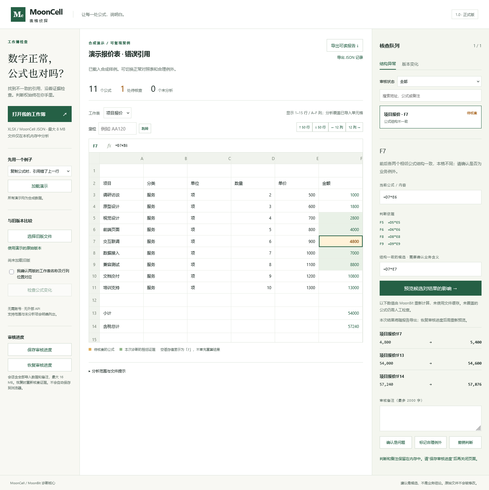

# MoonCell · 表格侦探

**诊断电子表格中可正常产生数值、但引用结构可疑的公式。**

1.0.0 是首个正式发布版，提供离线工作簿诊断和可恢复的人工审核流程。核心使用 MoonBit 编写，浏览器负责文件适配和展示。现有检测规则是保守的邻域结构基线，尚未证明超过 ExceLint 或其他成熟审计工具；不是完整 Excel 计算引擎，也不是已通过赛事审核的产品。

## 立即使用

从 [v1.0.0 Release](https://github.com/icyaaaww/mooncell/releases/tag/v1.0.0) 下载 `MoonCell.html` 后双击，或解压使用包后打开同名文件。源码仓库中位于 `dist/MoonCell.html`。页面包含四个明确标为合成数据的案例，也可打开自己的 `.xlsx` 或 MoonCell 工作簿 `.json`。不需要账号、API Key 或联网。

如需本地服务，安装 Node.js 22+ 后，在项目目录运行：

```sh
npm start
# http://127.0.0.1:4308/MoonCell.html
```

1. 在“错误引用”演示中查看 `F7` 和相邻证据。
2. 点击“预览候选对结果的影响”，查看明细、小计和总计的重新计算。
3. 切换“合理例外”，观察折扣也会触发候选，使用“标记合理例外”记录人工判断。
4. 导入新版及旧版，明确确认行列位置对应后检查公式变更。
5. 写下审核备注，点击“保存审核进度”；下次用“恢复审核进度”继续核查。
6. 导出可读 HTML 报告供同事阅读或打印；也可导出 JSON 供其他工具读取。

原文件不被修改。会话文件包含全部导入单元格、旧版和审核备注，恢复时校验 SHA-256 并重新计算发现。校验只检测内容变化，不证明文件真实性。HTML / JSON 报告不能用于恢复工作簿；旧的 0.1 报告会明确提示这一限制。

## 主分支后续维护

2026-10-20 的主分支已修复多工作表定位、增加完整队列翻页和 CLI 自动检查选项，并加强 XLSX 共享索引校验。HTML／JSON 报告可包含本次已计算的候选影响、计算失败信息和未分析提示；打开新工作簿或恢复会话后需重新预览。上述改进见主分支源码及 `dist/MoonCell.html`，现有 GitHub v1.0.0 下载资产和 Mooncakes 0.1.0 核心包保持原发布内容。

## 已实现

- MoonBit 公式词法/结构解析、相对引用指纹、绝对与混合引用平移、带引号及转义引号的跨表引用。
- 横向和纵向连续区域中，前后各两个同结构公式包围的孤立异常或固定数字检测。固定数字可能是有意输入，不会直接认定为误覆盖。展示四个邻域证据，提出对应平移公式作为候选。
- 同名工作表、同一地址的版本比较：新增、删除、公式变常量、公式结构变化。不会自动对齐行列插入、删除或重排。
- 候选在当前输入上重新核查；影响范围沿可解析的静态引用传播。受支持的数值公式重新计算，不把缓存值作为预览结果。
- XLSX / JSON 导入。XLSX 共享公式可通过 MoonBit 平移展开；中文、富文本共享字符串、普通内联字符串和隐藏工作表可读取。
- 人工分类和 2000 字备注、状态/地址/公式/备注筛选、手动 A1 定位及行列窗口移动。
- 带完整性校验的会话保存与恢复、转交同事的 HTML 报告、机器可读 JSON 记录。
- Web Worker 后台导入、诊断、比较和重算，支持取消；单次任务 30 秒超时后停止。失败或取消不会替换当前工作簿。
- 独立离线 HTML、CLI、移动窄屏布局；不调用外部 API、不自动存储工作簿。



## 能力边界

- 发现的是**异常候选**，不能证明业务错误。合理折扣会触发，少量公式、区域边界、连续多个错误可能漏检。没有候选不代表正确。
- 聚合范围缩短仅会在两版公式变化中被列出，**没有专用的漏算检测算法**。
- 预览支持数值 `+ - * /`、比较、一元正负、百分比和 `SUM / AVERAGE / MIN / MAX / COUNT / IF / ABS / ROUND`。`IF` 仅计算实际采用的分支；`ROUND` 位数限 -8 至 8，仍使用二进制浮点数，不保证 Excel 的所有舍入边界等价。不模拟 Excel 的所有隐式类型转换、错误值传播或精度特性。
- 动态引用、外部工作簿、命名范围、数组公式、宏、受保护加密文件不保证支持。无法解析的公式显示为未分析；预览失败显示具体原因。静态引用影响列表可能不包含通过动态/未知语法引用的下游。
- 规则不推断小计/合计的业务语义，不会自动修改、写回 XLSX。
- 输入最多 8 MB、20000 个单元格、2000 个公式；解压总量最多 32 MB，单个部件最多 12 MB；公式最多 4096 字符、512 个 token、64 层嵌套。预览最多 100 个受影响单元格，单个聚合范围最多 10000 格。
- 网页表格按选中位置展示一个有限窗口；分析覆盖所有成功导入的单元格。工作簿和审核状态仅保存在内存中，需主动保存会话（最大 16 MB）后关闭页面。会话不是 XLSX 格式备份，不含格式、图片和原始压缩包。主分支后续维护版按每页 50 项展示完整核查列表，可搜索缩小范围；报告包含全部发现。v1.0.0 下载版仍最多显示前 200 项。

## 开发与验证

### 作为 MoonBit 库使用

核心包 `icyaaaww/mooncell@0.1.0` 对应应用正式版 `v1.0.0`。当前发布工具要求包版本为 `0.x.y`，所以库与应用分别编号，应用功能没有降级。

```sh
moon add icyaaaww/mooncell@0.1.0
```

在调用包的 `moon.pkg` 中导入 `"icyaaaww/mooncell" @mooncell`，使用 `audit`、`compare`、`preview` 等 API。Mooncakes 包只包含 MoonBit 核心及测试，不包含浏览器界面、XLSX 适配器或 npm 依赖。示例和限制见 `README.mbt.md`。

### 构建应用与测试

本地验证版本：MoonBit `moon 0.1.20261012`，Node.js 24，Windows。构建需要 MoonBit 在 PATH 中，或者设置 `MOON_HOME`。应用运行不需要编译器。CI 固定安装 `0.10.15+943464bfa`，避免编译器更新改变生成接口。

```sh
npm ci
moon check --target js --deny-warn
moon test --target js --deny-warn
moon test --target wasm-gc --deny-warn
npm run build
npm test
npx playwright install chromium firefox
npm run test:browser
```

独立 Python/openpyxl 生成的四个 XLSX 文件已经包含在 `examples/`，运行测试不需要 Python。仅重新生成它们时运行 `python scripts/fixtures.py`，要求 `openpyxl`。

```sh
node scripts/cli.mjs audit examples/quotation-broken.xlsx
node scripts/cli.mjs compare examples/quotation-clean.xlsx examples/quotation-overwritten.xlsx --aligned
```

`--aligned` 表示调用方明确确认两个文件的工作表及行列位置对应。退出码 0 表示成功分析，不表示文件没有错误；错误输入或执行失败为 1。

主分支后续维护版增加 `--fail-on-findings`，可用于提交前脚本或 CI：发现候选／版本变化时返回 2，仍输出完整 JSON。没有候选返回 0；输入错误返回 1。未分析项仍需检查，不将退出码 0 当作业务正确证明。拼错的选项和多余文件参数会明确报错。

```sh
node scripts/cli.mjs audit examples/quotation-broken.xlsx --fail-on-findings
```

## 结构与来源

| 路径 | 职责 |
| --- | --- |
| `model.mbt` / `formula.mbt` | 公式表示、引用平移、解析及有限数值重算 |
| `audit.mbt` | 异常候选、版本变化、影响传播与候选核查 |
| `bridge/` | JSON 传输，不实现诊断规则 |
| `web/xlsx.mjs` | ZIP / XML 到单元格模型的文件适配 |
| `web/app.mjs` | 界面、人工审核、导航与导入导出 |
| `web/session.mjs` / `web/report.mjs` | 会话完整性、重新分析后恢复、可读报告 |
| `web/worker.mjs` / `web/background.mjs` | 后台任务及取消、超时 |
| `tests/` / `core_test.mbt` | 适配、交互、MoonBit 回归测试 |
| `docs/` | 选题边界、验证和真实用户试用任务 |

参考研究是 ExceLint；本版未移植其熵评分算法，也未复制其源代码。不把文件读写、公式计算、图遍历等通用能力当作独创贡献。现有 MoonBit `office.mbt` 和 `sheetcore` 的关联及首版采用独立有限实现的原因见 `docs/provenance.md`。

代码与应用正式版见 [GitHub](https://github.com/icyaaaww/mooncell)，核心包文档见 [Mooncakes](https://mooncakes.io/docs/icyaaaww/mooncell)。当前没有真实用户采用记录，未进行公开真实工作簿上的效果评估，也未提交报名。后续优先做真实表格误报验证和成熟基线对照。

Apache-2.0。JavaScript 适配依赖及编译运行时许可证见 `THIRD-PARTY-NOTICES.md`。
